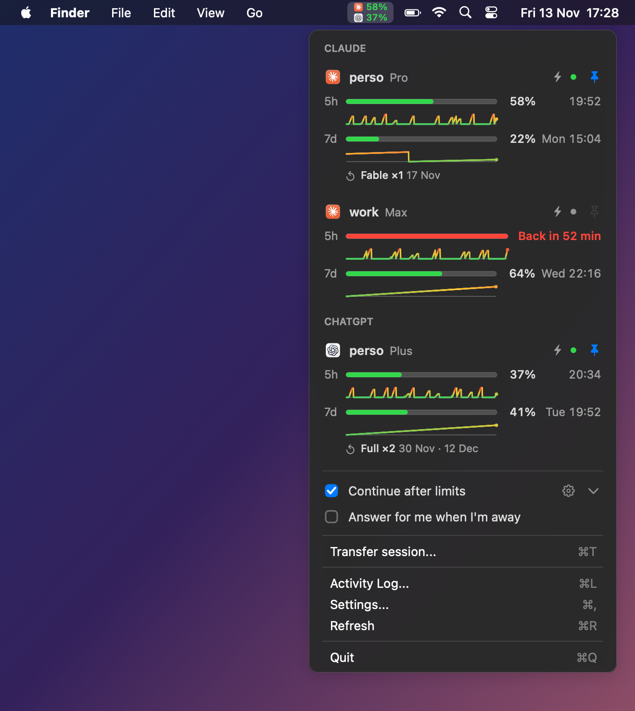
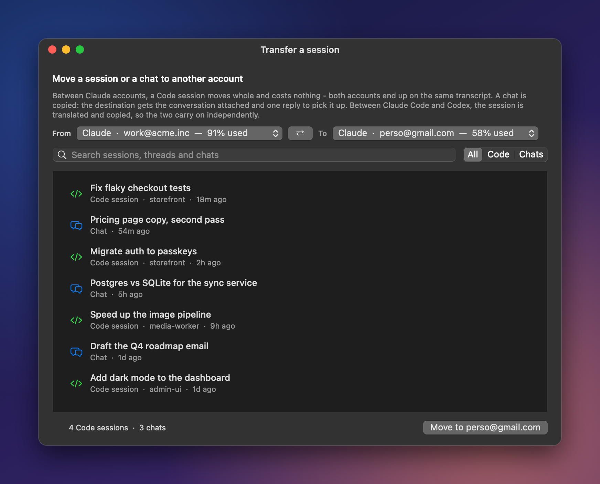
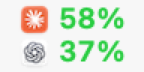
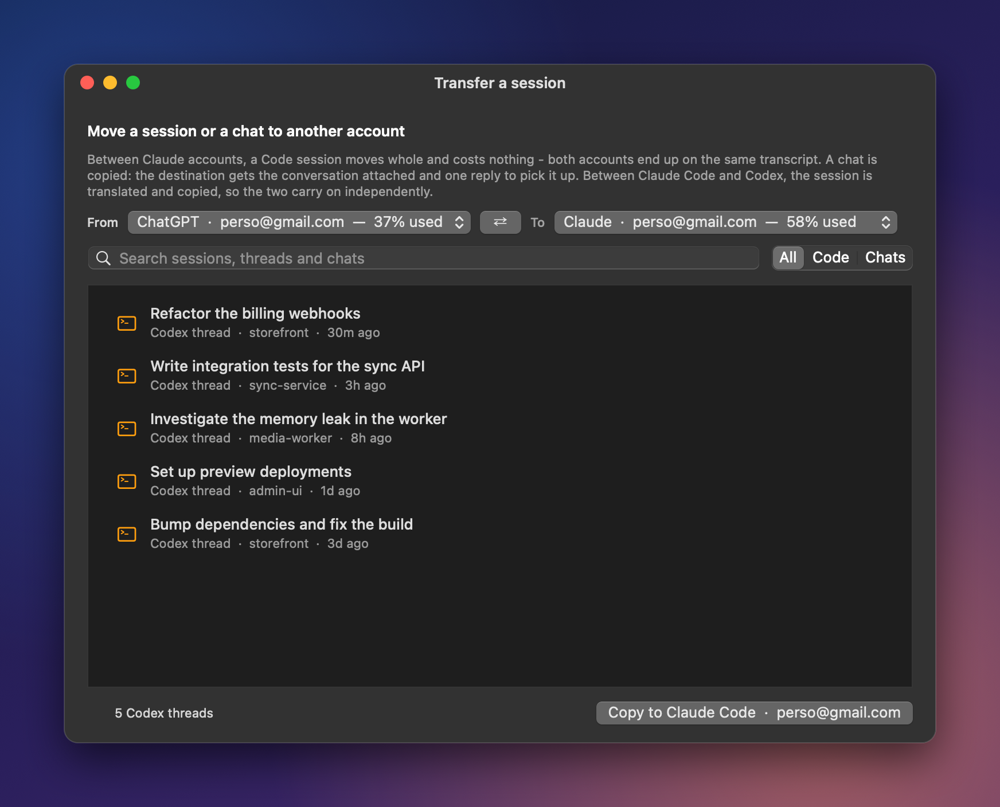
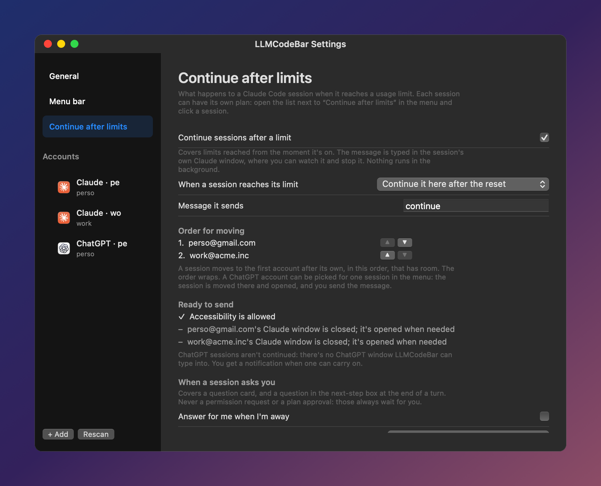
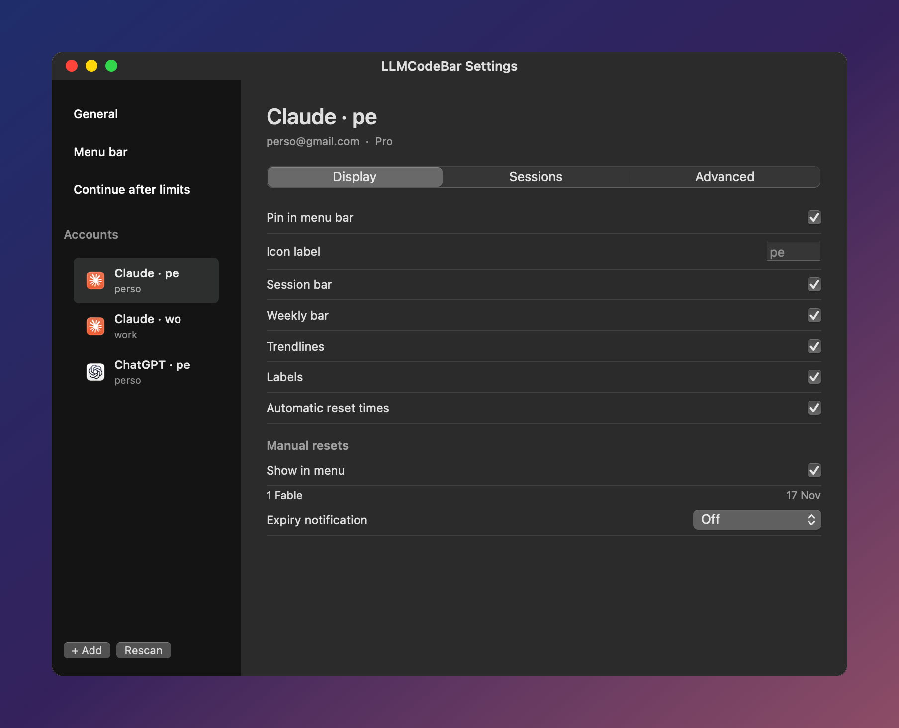

# LLMCodeBar

> Your Claude and ChatGPT limits in the menu bar. Built for running several accounts of the same provider, and auto starting your 5 hour session.



## Why this one

Plenty of menu bar apps show your Claude or ChatGPT usage. This one is built for two things they don't do.

**Run multiple accounts of the same provider.** Personal Claude and work Claude, right next to each other. Two ChatGPT logins. As many as you want, each in its own isolated window so they never clash. Click an account in the dropdown to open Claude or ChatGPT already signed into it.

**Auto start your 5 hour session.** The 5 hour window only starts counting from your first message, so an account you're not actively using never starts its clock. Turn this on and LLMCodeBar sends one tiny message on the cheapest model whenever the window is idle, so the session runs on a schedule instead of whenever you remember. Claude and ChatGPT, per account.

**Take a session to another account, or to the other agent.** Hit your limit mid task and you don't have to start over. Open **Transfer session...**, search your chats, Code sessions and Codex threads, pick where it goes, and carry on there with everything that was already said. That works between two Claude accounts, between Claude Code and Codex in either direction, and from any of them into a new T3 Code thread.



## Everything else

- Session (5h) and Weekly bars for every account, with reset times, grouped under a Claude and a ChatGPT heading.
- Notifications when a limit passes the percentage you pick (90% by default), when it's used up, and when a used-up limit resets.
- An Activity Log in the menu with everything that happened in the background: refresh errors, auto-started sessions, sessions continued after a limit, transfers, updates. The menu tells you when there's a new problem, and **Copy All** gives you a report to paste into an issue.
- A 7 day trend line per limit that goes green to red as you get close.
- Put accounts' 5h % right in the menu bar, each with its app icon so you know which is which. Click the pin next to any account in the dropdown to put it there or take it off, no need to open Settings. Settings > Menu bar sets the layout, from one account up to a 3 by 3 grid of nine, and can put a short label on each icon (the first 2 characters of the email unless you type your own) to tell two accounts of the same app apart. Pin one more than fits and the oldest one steps aside. When the accounts sit on one row there's room for more: the weekly % and how long until each limit resets (3d, 4h, 7m), stacked 5h above weekly or side by side, each part can be turned off.

  
- A bolt next to an account means auto start is on for it. Auto start picks the cheapest model the account offers each time, from the account's own model list, so it keeps working as models are retired. Click anywhere else on an account to open its app.
- Refresh from every 30 seconds to every 30 minutes.
- Keeps your Code history where you can find it. Claude files each Code session under the window it was created in, so when a re-login puts an account in your *other* Claude window, its whole history looks gone - it isn't, that window just has an empty folder for it. LLMCodeBar keeps every account's sessions present in every window, and offers to restart a window that has to reload them. It never overwrites a session the running app owns, and a session you delete stays deleted.
- Signs you in to the window you asked. With two Claude windows open, macOS hands a browser sign-in back to whichever one it likes, and the other one rejects it. LLMCodeBar holds the `claude://` link type, which makes Claude sign in inside its own window instead of sending you to the browser. Turn it off in Settings to hand the links back.
- Launch at login.
- Updates itself. It checks the releases page in the background, and installs a new version and restarts on its own. Turn that off in Settings and it offers the update in the menu instead. Every release is signed with the project's own key (not an Apple certificate), and an update whose signature doesn't check out is never installed.

## About transferring sessions

This is mostly what you want when one account hits its limit and you'd rather keep going on another than start the conversation again.

Each kind travels differently, because each one is stored somewhere very different.

**Claude Code sessions really move.** The desktop app keeps a small metadata file per session inside each account's folder, and it only points at the transcript, which lives in `~/.claude/projects` and belongs to no account in particular. LLMCodeBar copies that metadata into the other account, so:

- The whole session arrives, not a summary of it. It costs nothing and takes no time.
- Both accounts point at the *same* transcript, so continuing in the second account continues the same history, and the first account sees it too. It's as close to one session in two accounts as the machine allows.
- Because it is one file, don't run the same session in both accounts at once.
- The session appears at the top of the other account's Code list. Claude only reads that list when it launches, so if that account's window is already open it has to restart first - LLMCodeBar offers to do it for you.

**Chats are copied, not moved.** Claude has no way to hand a conversation to another account: a conversation belongs to one organization, there's no import, and sharing only produces a read-only snapshot. So LLMCodeBar exports the chat and opens a new one in the account you chose, attaching the whole conversation and asking Claude to continue from where it stopped. That means:

- The new chat holds one message - your transcript, attached - and Claude's one line "here's where we are" reply. Everything that was said is in the attachment, and Claude has read it.
- It costs one message of the destination account's usage.
- The two chats are independent afterwards. Nothing you say in one shows up in the other. Moving it back later is the same two clicks in reverse.
- Text comes across, files and images don't - they stay in the original account, and the transcript just names them.
- Very long conversations are trimmed to the most recent part, and the menu says so when that happens.
- The new chat's link is copied to your clipboard, and the destination Claude opens straight to it when it's the only Claude window running.

**Claude Code and Codex trade sessions both ways.** The two agents store sessions in unrelated formats, so the session is translated and the destination gets its own copy. They carry on independently afterwards.

- **Claude Code to Codex** goes through Codex's own importer, the one built into the `codex` tool that ships inside the ChatGPT app. The thread comes out exactly as Codex would make it, and ChatGPT opens straight to it. Moving the same unchanged session twice just takes you back to the thread it made the first time.
- **Codex to Claude Code** writes a real Claude Code transcript: Codex's messages become the conversation, its shell commands become `Bash` calls with their output, and file edits and other tools become short notes. It shows up in the destination account's Code list (restart that Claude if it was open, LLMCodeBar offers to), and `claude --resume` sees it too.
- Very long Codex threads leave out their oldest command output so the session stays a size Claude can pick up. Messages are always kept.
- Nothing is sent anywhere. Both directions are local file work, so it costs no usage.



**Anything can start a T3 Code thread.** Pick **T3 Code · New thread** as the destination for a chat, a Code session or a Codex thread. T3 has no way to take over another app's session, so LLMCodeBar starts a new thread in the session's folder (a chat asks you for one) and gives it the conversation as its first message, like T3 does itself when a thread changes provider. The agent reads it, sums up where things stand and waits for you. A long conversation keeps its first message and as much of the end as fits. It goes through T3's own `t3` command, so T3 Code has to be open, and a folder T3 doesn't know yet is added as a project.

## Keeping work going past a limit

Tick **Continue after limits** in the menu (or in Settings > Continue after limits) and a Claude Code session that reaches a usage limit carries on by itself. The chevron next to the checkbox opens the list of your sessions from the last 3 hours, right in the menu: what each one is doing (working, idle, waiting for reset, moving, sending, needs you) and what happens at its limit.



What happens is up to you, per session or for all of them (the gear opens the defaults):

- **Continue here**: wait for the account's reset, then send the message in the same window. LLMCodeBar wakes at the reset time itself.
- **Move to another account**: hand the session to the account you pick, or the next one in your order that has room, and send the message there straight away. When every account is full, it continues on whichever one is back first.
- **Leave it**.

The message is "continue" unless you change it, for one session or for all. Click a session in the list to change its plan, the account it moves to, or its message; the line under it says "default" or "custom", and "Use defaults" puts it back.

It happens in the Claude window, where you can watch the turn and stop it. Nothing ever runs in the background. LLMCodeBar fills the session's reply box and presses Send through macOS Accessibility, so it needs that permission, and it never types into the app you're using. When the window can't take the message (an unsent draft, the window won't open), the session shows "needs you", a notification says why, and nothing is sent until you try again. Turning it on only covers limits reached from then on; one already reached shows "Continue now". Moving pauses after 8 moves in 12 hours, in case something loops.

### When a session asks you something

A session can also stop because it's waiting on you: a question card, a plan to approve, or a question at the end of its turn. Those show at the top of the same list, with the question word for word, as **asking you**. Tick **Answer for me when I'm away** and, once you've had no keyboard or mouse for 10 minutes (or the screen is locked), LLMCodeBar answers in the session's window:

- **Decide for me**: it goes with what it would recommend, and leaves anything that can't be undone for you.
- **Do what you can without it**: it leaves the question for you and carries on with the rest.
- **Wait for me**: nothing is sent, you get a notification.

Pick one per session in the list, or for all of them in Settings, where both messages can be changed. While you're at the Mac you only get a notification, with the same two answers on it. Plan approvals and permission requests are never answered for you. A turn that only ends on a "?" is shown but not answered unless you tick it in Settings, since it's often an offer more than a question. A session gets at most 3 answers an hour.

ChatGPT accounts can be picked as the place to move one session to. LLMCodeBar imports the session into ChatGPT and opens it there, but you send the message, since it doesn't type into ChatGPT. For the same reason it never picks ChatGPT on its own, and ChatGPT sessions aren't continued automatically; you get a notification when one can carry on.

## Install

Download **LLMCodeBar.dmg** from the [latest release](https://github.com/Franciskid/LLMCodeBar/releases/latest), open it, drag the app to Applications.

It isn't notarized (that needs a paid Apple Developer ID), so macOS blocks the first launch. Right click the app and pick Open, or run:

```sh
xattr -dr com.apple.quarantine "/Applications/LLMCodeBar.app"
```

That first launch is the only time you have to do this. From then on LLMCodeBar keeps itself up to date: it checks for a new release in the background, checks its signature, swaps itself out and restarts, quarantine flag and all.

macOS 13 or newer, universal (Apple Silicon and Intel). You also need the Claude and/or ChatGPT desktop apps installed and signed in.

## Settings

Settings uses a sidebar: **General** for startup, refresh, updates, cookie access, Claude integration, limit notifications and macOS notification permission; **Menu bar** for grid size, fill order, icon labels, weekly percentage, quota countdowns, arrangement, and preview. **Continue after limits** for what happens to a session at its limit, the message it sends, the order accounts take over in, and answering while you're away. Select an account to open its **Display**, **Sessions**, and **Advanced** sections. Existing preferences, pinned accounts, and custom icon labels are preserved.

The dropdown groups accounts under a Claude and a ChatGPT heading. Each account is a header line (name, plan, auto-start, open or closed, menu bar pin) and one line per limit: bar, percent used and reset time, or when it's back once it's used up. Each account controls its own bars, trendlines, labels, automatic reset times, and manual-reset visibility. Manual resets sit on one line under the limits with a count and short dates, such as `Fable ×1 17 Nov` or `Full ×3 30 Nov · 1 Dec · 12 Dec`. Current-year dates omit the year; no hour or “expires” prefix is shown.

**Manual resets** shows the saved reset allowances on each account, grouped by kind and redemption deadline: Full, 5-hour, Weekly, or Fable. Claude's grant inventory and Codex's banked reset-credit inventory supply the counts and expiry dates. These are separate from automatic 5-hour and weekly quota timers. Expired, spent, and paused grants are excluded; upcoming grants show when they become available. If a read fails, cached counts are marked and the app never reports a failed read as a zero balance.

On an account’s **Display** section, **Show in menu** controls manual-reset visibility. **Expiry notification** can notify 1, 6, 24, or 72 hours before a manual reset expires. Allow macOS notifications when prompted. This is a reminder to redeem a saved reset before its deadline; it does not notify about automatic usage-window refreshes or consume any reset. Redemption remains in the provider's own Usage settings. The app must be running to refresh and schedule alerts; macOS Focus and notification settings control delivery.

### T3 Code transfers

Into T3: choose an account as the source, then **T3 Code · New thread** as the destination (see above).

Out of T3: choose **Transfer session… → From → T3 Code · Local conversations**, then select a Claude or ChatGPT account. Search the list, select a thread, and copy it to Claude Code or Codex. Copying reads completed user and assistant messages from the local T3 V2 database (`~/.t3/userdata/statev2.sqlite`) without modifying T3. The working directory and message order are preserved. Claude Code receives a new transcript; Codex receives a translated transcript through its own importer. Both continue independently from the T3 conversation.

Attachments, tool executions, pending replies, hidden reasoning, and provider session state are not copied. Review the destination's history before continuing; project files remain in their original working directory. Remote environments, custom T3 data directories, and legacy V1 databases are not supported in this release. T3 has no whole-thread export command; this adapter uses its current local projection schema and reports an error if that schema changes. See [T3's migration and storage documentation](https://github.com/pingdotgg/t3code/blob/main/docs/user/thread-migration.md).




## How it gets the data

Local and read only, on your own accounts. Nothing leaves your machine except the usual requests to Anthropic and OpenAI.

- Reads your signed in Claude and ChatGPT profiles in `~/Library/Application Support` for the account and plan.
- Claude: your session cookies plus the claude.ai usage endpoint. ChatGPT: the OpenAI login token in `auth.json` plus the ChatGPT usage endpoint.
- Saves a small config and a 7 day usage history for the sparklines.

When Claude isn't running, it decrypts Claude's cookie key and macOS asks for your password once. Click **Always Allow** and it caches the key so it stops asking, or turn off **Auto approve cookie access** in Settings to keep it away from the keychain entirely.

These are the apps' internal endpoints, not official ones, so they can break if the providers change them.

## Build

```sh
git clone https://github.com/Franciskid/LLMCodeBar.git
cd LLMCodeBar
./scripts/install.sh   # build, install, launch
```

Plain Swift and AppKit, no Xcode project, no deps.

`./scripts/test.sh` runs the checks. `./scripts/release.sh notes.md` builds the version in `Info.plist`, signs the disk image with the update key from your login keychain (no Apple account involved), checks the signature and publishes the release.

## License

MIT.
